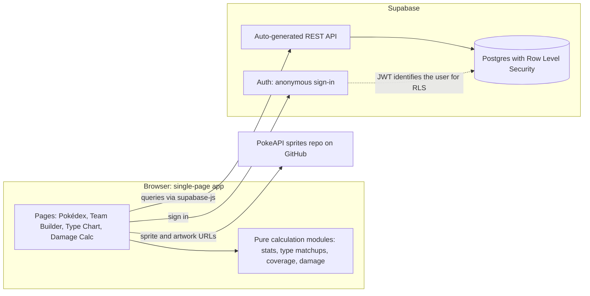
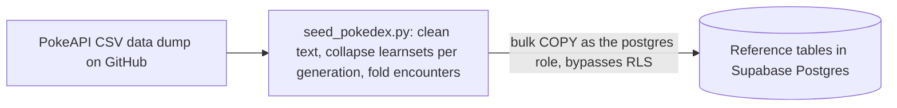
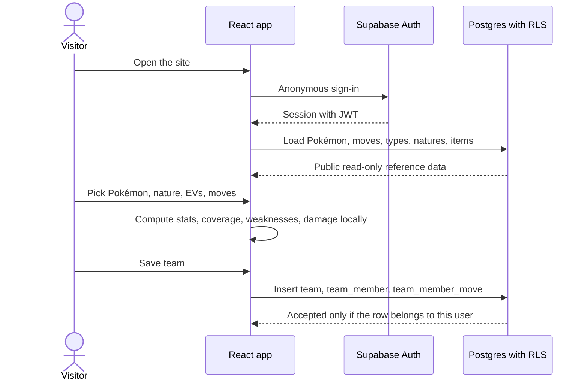
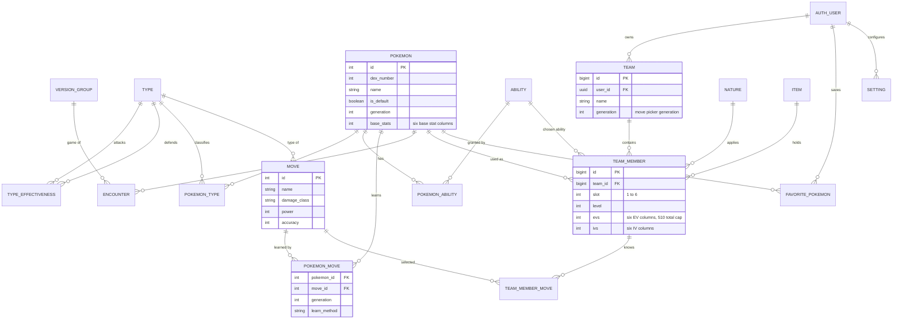

# Pokédex & Team Builder

A public web app for browsing every Pokémon across all generations and building competitive teams. Pick a team of six, customize natures, EVs/IVs, items, and moves, then see how well it covers the type chart, what it is weak to, and how fast it is. Teams are saved to a cloud database, so they are still there when you come back.

> **Status:** database schema and seed pipeline are done; frontend is in progress. See the [roadmap](#roadmap).

---

## Features

### Pokédex (all generations)
- Search and filter by name, type, and generation
- Detail pages: artwork, description, types, abilities, base stats, and alternate forms
- Learnsets with a **generation/game selector** (level-up, TM, egg, and tutor moves)
- Locations (where to find it) per game

### Team builder
- Six slots per team, with any number of saved teams
- Per Pokémon: nickname, level, nature, ability, held item, EVs, IVs, and four moves
- Live final-stat calculation as you edit
- **Move picker filtered by generation:** only moves the Pokémon can learn in the selected generation are offered
- Showdown-style text import/export

### Team analysis
- **Type coverage:** which types your moves hit super-effectively
- **Weaknesses:** shared weaknesses and resistances across the team
- **Speed chart:** your team's final Speed stats side by side
- **"Team loses to" view:** threat types that hit multiple members super-effectively

### Tools
- **Interactive type chart:** click an attacking or defending type to see every matchup
- **Damage calculator:** standard damage formula with STAB, type effectiveness, critical hits, and the 85–100% roll range

### Saved data
- Teams, favorites, and settings (such as default generation) stored per user
- No signup required: visitors get an anonymous account automatically

---

## Scope decisions

| Area | Rules used | Why |
|------|-----------|-----|
| Pokédex data | All generations | Browsing is just more rows, so it is cheap |
| Move picker | Learnsets for the selected generation | Stored per generation, which keeps the database small |
| Stat calculation | Modern formula (Gen 3+) | One formula to implement and test |
| Type chart and analysis | Modern 18-type chart (Gen 6+, includes Fairy) | Matches what players use today |
| Damage calculator | Standard formula, no abilities/items/weather in v1 | Those interactions multiply edge cases quickly |

**Not in scope (stretch goals):** full team-vs-team battle simulation, pre-Gen 3 stat systems (DVs/Stat Exp), historical type charts, event-move and transfer legality rules.

---

## Architecture

### System overview



All calculations (final stats, coverage, weaknesses, speed, damage) run in the browser from data already loaded, so editing a team feels instant and the database only stores what the user chose.

### Data pipeline



The seed runs once. Reference data is read-only to the app afterward.

### Building and saving a team



### Database model



Two groups of tables:
- **Reference data** (seeded once, public read-only): `version_group`, `type`, `type_effectiveness`, `pokemon`, `pokemon_type`, `ability`, `pokemon_ability`, `move`, `pokemon_move`, `encounter`, `nature`, `item`
- **User data** (read/write, owned by one user): `team`, `team_member`, `team_member_move`, `favorite_pokemon`, `setting`

### Security model

Row Level Security is enabled on every table:
- Reference tables allow `SELECT` for everyone and have no write policies, so only the seed script (which connects as the database owner) can change them.
- User tables only allow a user to see and edit rows they own. Team members and their moves inherit ownership through the parent team.
- EV and IV limits (252 per stat, 510 total, IVs 0–31) are `CHECK` constraints, so the database rejects invalid builds even if the UI has a bug.

---

## Rules implemented

**Final stats (Gen 3+):**

```
HP    = floor((2*Base + IV + floor(EV/4)) * Level / 100) + Level + 10
Other = floor((floor((2*Base + IV + floor(EV/4)) * Level / 100) + 5) * NatureMultiplier)
```

`NatureMultiplier` is 1.1 for the boosted stat, 0.9 for the lowered stat, and 1.0 otherwise.

**Damage (v1):**

```
Base   = floor(floor(floor(2*Level/5 + 2) * Power * Attack / Defense) / 50) + 2
Damage = floor(Base * Random(0.85 to 1.00) * STAB * TypeEffectiveness * Crit)
```

STAB is 1.5 and a critical hit is 1.5. Abilities, items, weather, and terrain are out of scope for v1.

---

## Tech stack

| Layer | Choice |
|-------|--------|
| Database | Postgres on Supabase (free tier) |
| Auth | Supabase Auth with anonymous sign-ins |
| API | Supabase auto-generated REST API via `supabase-js` |
| Frontend | React + Vite *(planned)* |
| Hosting | Static host such as Vercel, Netlify, or Cloudflare Pages *(planned)* |
| Data source | PokeAPI CSV dump and sprite repository |
| Seeding | Python 3 with `psycopg` |

### Free-tier notes
- The reference data is roughly **42 MB**, well under the 500 MB database limit.
- Free Supabase projects **pause after about a week of inactivity**. Open the dashboard and confirm the project is running before a demo.

---

## Getting started

1. **Create a Supabase project** at [supabase.com](https://supabase.com).
2. **Create the tables:** open the SQL editor and run `db/schema_postgres.sql`.
3. **Enable anonymous sign-ins** in the project's Authentication settings.
4. **Seed the reference data:**
   ```bash
   pip install "psycopg[binary]"
   export DATABASE_URL="postgresql://postgres:<password>@<host>:5432/postgres"
   python scripts/seed_pokedex.py --dry-run   # check row counts first
   python scripts/seed_pokedex.py             # load into the empty database
   ```
   Use the connection string from Supabase's Connect dialog. If your network has no IPv6, use the Session pooler string.
5. **Run the frontend** *(planned)*: add your Supabase project URL and public API key to a `.env` file, then `npm install` and `npm run dev`.

Re-seeding with `--reset` wipes the reference tables and also deletes any saved teams, so only use it before real users arrive.

### Seed data notes
- Names are stored as PokeAPI identifiers (`mr-mime`, `thunder-punch`); the frontend formats them for display.
- Default forms use the plain species name. Mega, Gigantamax, and regional forms are separate rows with `is_default = false`.
- Learnsets exclude Let's Go, Legends: Arceus, and Legends: Z-A so spin-off movepools do not appear in mainline learnsets.
- Only held items are loaded, since those are what the team builder needs.

---

## Planned repository layout

```
.
├── db/
│   └── schema_postgres.sql      # tables, constraints, RLS policies
├── scripts/
│   └── seed_pokedex.py          # PokeAPI CSV -> Supabase Postgres
├── src/                         # frontend (planned)
│   ├── lib/                     # supabase client, calculation modules
│   └── pages/                   # Pokédex, Team Builder, Type Chart, Damage Calc
└── README.md
```

---

## Roadmap

Estimated hours for the 30–40 hour project budget:

| Milestone | Est. hours | Status |
|-----------|-----------:|--------|
| Database schema, RLS, seed pipeline | — | Done |
| Pokédex list and detail pages (all generations) | 5–7 | Not started |
| Basic team builder with live stats | 6–8 | Not started |
| Saved teams, favorites, Showdown import/export | 3–4 | Not started |
| Interactive type chart | 2–3 | Not started |
| Team analysis: coverage, weaknesses, speed chart | 4–6 | Not started |
| "Team loses to" threat view | 3–5 | Not started |
| Damage calculator | 4–6 | Not started |
| Generation selector for learnsets and locations | 4–6 | Not started |
| Stretch: team-vs-team matchup, natural-language search | — | Not planned yet |

---

## Course requirements

| Requirement | How this project meets it |
|-------------|---------------------------|
| Something genuinely interesting | A Pokémon reference and team-building tool |
| Reads and writes data | Reads the Pokédex from Postgres; writes teams, favorites, and settings per user |
| Uses AI to build something better than alone | AI assisted with schema design, the seed pipeline, and testing *(add more detail as the build continues)* |
| 30–40 hours | See the roadmap estimates above |

---

## Credits

Pokémon data and sprites come from [PokeAPI](https://pokeapi.co/). This is a non-commercial fan project for a class and is not affiliated with Nintendo, Game Freak, or The Pokémon Company. Pokémon and all related names are trademarks of their respective owners.
